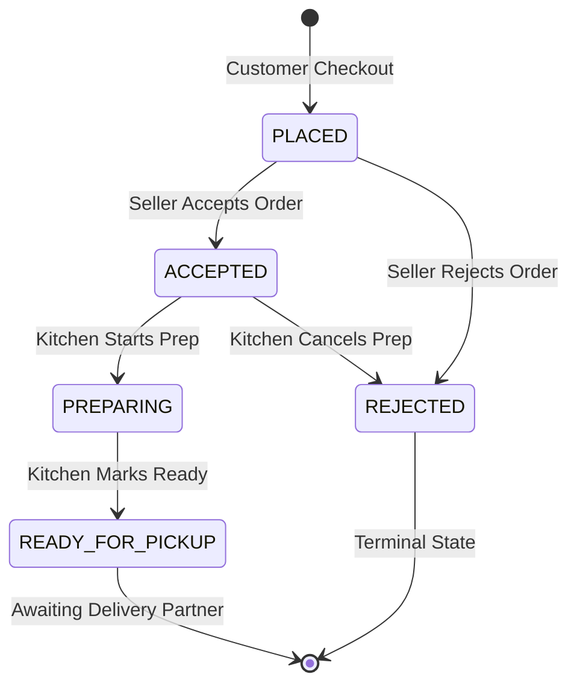

# Mini Swiggy V3 — Seller Dashboard and Restaurant Management System

> **Version**: V3  
> **Architecture**: Multi-Tier Distributed Application (Browser Web Clients ⇄ HTTP API Gateway ⇄ TCP Socket Server ⇄ SQLite3)  
> **Local Base Port**: HTTP Gateway (`127.0.0.1:8000`) | TCP Backend (`127.0.0.1:5000`)

---

## 1. Overview & Objectives

Mini Swiggy V3 transforms the system from a customer-only ordering portal into a **two-sided food delivery platform**, empowering restaurant sellers to manage incoming orders and kitchen menus in real time.

Both customer and seller interfaces operate concurrently over the **same single HTTP Gateway**, forwarding requests over **Berkeley TCP stream sockets (NDJSON)** to a unified **Authoritative TCP Server** backed by an ACID-compliant **SQLite database**.

```
┌─────────────────────────────────┐       ┌─────────────────────────────────┐
│     Customer Web Interface      │       │    Seller Kitchen Dashboard     │
│   (http://127.0.0.1:8000/)      │       │  (http://127.0.0.1:8000/seller) │
└────────────────┬────────────────┘       └────────────────┬────────────────┘
                 │                                         │
                 │ HTTP REST (Port 8000)                   │ HTTP REST (Port 8000)
                 ▼                                         ▼
┌───────────────────────────────────────────────────────────────────────────┐
│             Tier 2: Lightweight Threading HTTP Gateway                    │
│                        (gateway/http_gateway.py)                          │
│   - Concurrent ThreadingHTTPServer                                        │
│   - Path-Traversal Guarded Static File Serving                            │
│   - REST HTTP to NDJSON Socket Translation                                │
│   - Short-Lived TCP Sockets (Connection-per-Request)                      │
└─────────────────────────────────────┬─────────────────────────────────────┘
                                      │
                                      │ TCP Stream Socket (NDJSON Framing)
                                      │ 127.0.0.1:5000
                                      ▼
┌───────────────────────────────────────────────────────────────────────────┐
│             Tier 3: Core TCP Socket Server & Request Handler              │
│                 (server/tcp_server.py & request_handler.py)               │
│   - Single-Threaded Framing Buffer Loop (recv chunking + \n slicing)      │
│   - Zero-Trust Business Validation & Server-Side State Machine            │
│   - Seller Authorization & Multi-Tenant Isolation Enforcement             │
└─────────────────────────────────────┬─────────────────────────────────────┘
                                      │
                                      │ In-Process SQLite Engine
                                      ▼
┌───────────────────────────────────────────────────────────────────────────┐
│                    Tier 4: Relational Persistence                         │
│                     (database/schema.sql & db.py)                         │
│   - SQLite3 ACID Database (swiggy.db)                                     │
│   - Point-in-time Price Snapshotting in order_items                       │
│   - Foreign Key Constraints & PRAGMA foreign_keys = ON                    │
└───────────────────────────────────────────────────────────────────────────┘
```

---

## 2. Key Features in V3

1. **Dedicated Seller Kitchen Dashboard (`/seller` or `/seller.html`)**:
   - Polished dark kitchen theme with Swiggy orange accents (`#fc8019`).
   - Real-time KPI summary cards (Total Orders, Pending, Accepted, In Preparation, Ready for Pickup, Menu Items).
   - Live incoming order queue with lifecycle filtering (All, Pending, Accepted, Preparing, Ready for Pickup, Rejected).
   - Interactive order lifecycle control (Accept, Reject, Start Preparation, Mark Ready for Pickup).
   - Order detail snapshots showing snapshotted line-item prices, customer details, and payment verification.

2. **Full Menu Management**:
   - Real-time menu inventory overview.
   - Add new food items with name, positive price, and description.
   - Edit existing menu item details (name, price, description).
   - Instant availability toggle switch (Available vs. Sold Out).
   - Sold out items are immediately blocked from new customer orders.
   - Immutable price snapshotting: changing current menu price never alters past customer order records or totals.

3. **Multi-Tenant Seller Authorization & Security**:
   - Zero-trust backend validation: the backend resolves restaurant ownership via database queries on `restaurants.owner_user_id`.
   - Sellers can only view, accept, reject, or advance orders belonging to their own kitchen.
   - Sellers cannot edit or toggle menu items of rival restaurants.
   - Non-sellers (customers, delivery partners, admins) attempting seller operations are rejected with HTTP 403 / `UNAUTHORIZED_ROLE`.

4. **Bi-Directional Customer-to-Seller Synchronization**:
   - Status updates performed in the Seller Hub (`ACCEPTED`, `PREPARING`, `READY_FOR_PICKUP`) instantly reflect in the customer's order history and digital receipts.

---

## 3. Order Status Lifecycle State Machine

The authoritative backend enforces a strict finite state machine for order transitions:



### Transition Invariants
- An order in `placed` (or `pending`) cannot jump straight to `preparing` without being `accepted` first.
- An order that has been `rejected` or `cancelled` cannot transition to `accepted` or `preparing`.
- An order already in `preparing` cannot be rejected.
- An order already `ready_for_pickup` cannot be modified by the kitchen.

---

## 4. API Specification

### 4.1 HTTP Gateway Endpoints

| Method | Endpoint | Description | Query / Body Params | Status Code |
|---|---|---|---|---|
| `GET` | `/seller` | Serves Seller Dashboard HTML | None | 200 |
| `GET` | `/api/seller/profile` | Retrieve seller identity, kitchen info, and stats | `seller_id=<int>` | 200, 400, 403, 404 |
| `GET` | `/api/seller/orders` | Retrieve incoming orders for seller's kitchen | `seller_id=<int>&status=<filter>` | 200, 400, 403 |
| `GET` | `/api/seller/orders/{order_id}` | Retrieve specific order detail with authorization | `seller_id=<int>` | 200, 400, 403, 404 |
| `POST` | `/api/seller/orders/{order_id}/status` | Update order lifecycle status | `{"seller_id": int, "status": str}` | 200, 400, 403, 409 |
| `GET` | `/api/seller/menu` | List menu items for seller's kitchen | `seller_id=<int>` | 200, 400, 403 |
| `POST` | `/api/seller/menu` | Add a new menu item | `{"seller_id": int, "name": str, "price": float, "description": str, "is_available": int}` | 201, 400, 403, 422 |
| `PATCH` | `/api/seller/menu/{item_id}` | Edit an existing menu item | `{"seller_id": int, "name": str, "price": float, "description": str}` | 200, 400, 403, 404, 422 |
| `PATCH` | `/api/seller/menu/{item_id}/availability` | Toggle item availability | `{"seller_id": int, "is_available": 0 \| 1}` | 200, 400, 403, 404, 422 |
| `OPTIONS`| `/api/*` | CORS preflight handler | None | 204 |

### 4.2 TCP NDJSON Protocol Actions

All TCP requests follow the standard newline-delimited JSON format:
`{"request_id": "<id>", "action": "<action_name>", "payload": { ... }}\n`

| Action | Payload Parameters | Successful Response Data | Error Codes |
|---|---|---|---|
| `get_seller_profile` | `{"seller_id": 2}` | `{"seller": {...}, "restaurant": {...}, "stats": {...}}` | `NOT_FOUND`, `UNAUTHORIZED_ROLE`, `FORBIDDEN` |
| `get_seller_orders` | `{"seller_id": 2, "status": "pending"}` | `[{"order_id": 1, "items": [...], ...}]` | `NOT_FOUND`, `UNAUTHORIZED_ROLE`, `FORBIDDEN` |
| `get_seller_order` | `{"seller_id": 2, "order_id": 1}` | `{"order_id": 1, "customer_name": "...", "items": [...]}` | `NOT_FOUND`, `FORBIDDEN` |
| `update_order_status` | `{"seller_id": 2, "order_id": 1, "status": "accepted"}` | `{"order_id": 1, "order_status": "accepted", ...}` | `INVALID_TRANSITION`, `FORBIDDEN` |
| `get_seller_menu` | `{"seller_id": 2}` | `[{"item_id": 1, "name": "...", "price": 180.0, ...}]` | `FORBIDDEN`, `NOT_FOUND` |
| `add_menu_item` | `{"seller_id": 2, "name": "...", "price": 250.0}` | `{"item_id": 7, "name": "...", "price": 250.0}` | `INVALID_PAYLOAD`, `FORBIDDEN` |
| `update_menu_item` | `{"seller_id": 2, "item_id": 1, "price": 200.0}` | `{"item_id": 1, "price": 200.0}` | `NOT_FOUND`, `FORBIDDEN`, `INVALID_PAYLOAD` |
| `update_menu_item_availability`| `{"seller_id": 2, "item_id": 1, "is_available": 0}` | `{"item_id": 1, "is_available": 0}` | `NOT_FOUND`, `FORBIDDEN`, `INVALID_PAYLOAD` |

---

## 5. Database Schema & Migration

### Schema Updates in `database/schema.sql`
1. **`restaurants.owner_user_id`**:
   - Foreign key referencing `users(user_id)`.
   - Seed data maps Bob Seller (`user_id = 2`) as the verified owner of **Hyderabad Spice House** (`restaurant_id = 1`).
2. **`orders.order_status` CHECK Constraint**:
   - Expanded to include `'ready_for_pickup'` and `'rejected'`:
     ```sql
     CHECK (order_status IN (
         'placed', 'accepted', 'preparing',
         'ready', 'ready_for_pickup', 'out_for_delivery', 'delivered', 'cancelled', 'rejected'
     ))
     ```
3. **Idempotent Migration Helper in `database/db.py`**:
   - `migrate_db()` automatically migrates existing SQLite tables if the database was initialized in V0–V2 without losing historical order records.

---

## 6. How to Run & Test the Application

### 6.1 Database Initialization
```powershell
python main.py init
python main.py seed
```

### 6.2 Starting the Servers
Open two terminal windows:

**Terminal 1 — Core TCP Server (Port 5000)**:
```powershell
python server/tcp_server.py
```

**Terminal 2 — HTTP API Gateway (Port 8000)**:
```powershell
python gateway/http_gateway.py
```

### 6.3 Accessing the Application
- **Customer Storefront**: `http://127.0.0.1:8000/`
- **Seller Kitchen Dashboard**: `http://127.0.0.1:8000/seller`

---

## 7. Customer-to-Seller Workflow Walkthrough

1. **Step 1 (Customer Places Order)**:
   - Navigate to `http://127.0.0.1:8000/`.
   - Select **Hyderabad Spice House**, add *Chicken Biryani* to cart, and click **Place Order**.
   - Notice the order is placed with status `PLACED`.
2. **Step 2 (Seller Receives and Accepts Order)**:
   - Switch to `http://127.0.0.1:8000/seller`.
   - Bob Seller sees the new incoming order under **Live Orders**.
   - Click **✓ Accept Order**. Status changes to `ACCEPTED`.
3. **Step 3 (Kitchen Starts Preparation)**:
   - Click **👨‍🍳 Start Preparing**. Status changes to `PREPARING`.
   - Switch back to customer orders tab on `http://127.0.0.1:8000/`: the customer receipt immediately shows `PREPARING`.
4. **Step 4 (Kitchen Marks Ready)**:
   - Click **📦 Mark Ready for Pickup**. Status changes to `READY_FOR_PICKUP`.
   - Customer view reflects `READY_FOR_PICKUP`.
5. **Step 5 (Menu Management & Item Availability)**:
   - Click **Menu Management** tab in Seller Hub.
   - Toggle *Veg Biryani* to **Sold Out**.
   - Switch to Customer Storefront: customer cannot add or order *Veg Biryani* (`ITEM_UNAVAILABLE` error).
   - Toggle back to **Available**: customer can order normally.

---

## 8. Automated Test Suite

Run all tests across V0, V1, V2, and V3:
```powershell
python -m pytest tests -v
```

**Result**: 164 passed in ~50 seconds.

---

## 9. Distributed Systems Concepts & Limitations

### Concepts Demonstrated
- **Two-Sided Multi-Tier Topology**: Multiple distinct frontend roles (Customer vs. Seller) interact via the same protocol translation gateway.
- **Role-Based Access Control (RBAC) & Tenant Isolation**: Zero-trust server-side validation ensures sellers cannot tamper with competitor kitchens.
- **State Machine Invariants**: Atomic state transitions prevent invalid lifecycle modifications (e.g., preparing rejected orders).
- **Point-in-Time Snapshotting**: Historical price consistency guarantees accounting integrity despite future menu edits.

### Educational Design Limitations
- **Development-Only Authentication**: User identities are passed as development parameters (`seller_id=2`, `customer_id=1`). Production JWT/session tokens and cryptographic authentication are intentionally deferred to future iterations.
- **Single Backend Instance**: The TCP server is a single-node daemon. Load balancing, Raft consensus, and distributed database sharding are not implemented.
