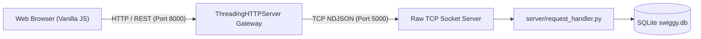
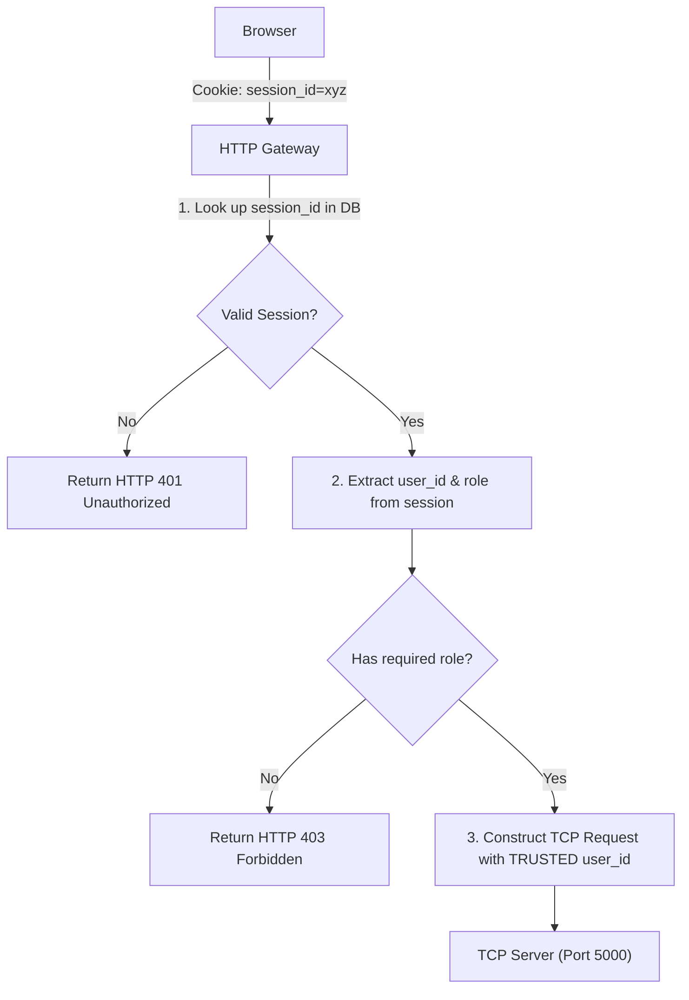
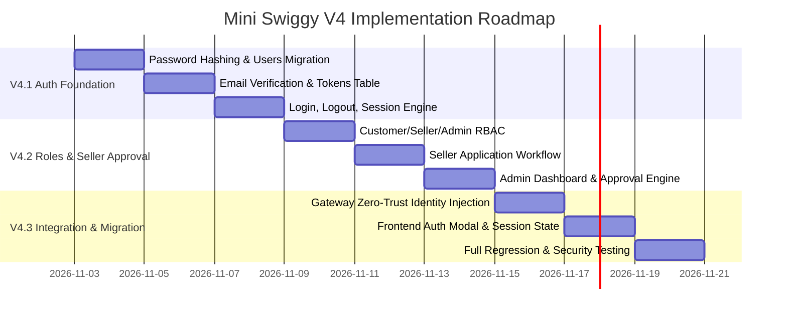

# Mini Swiggy V4 — Architecture & Implementation Plan
## Multi-User Identity, Authentication, and Role-Based Access Control

---

## 1. Executive Summary & V3.2 Integration Status

### 1.1 V3.2 Merge Status
- **Source Branch**: `feature/v3-2-refund-management`
- **Target Branch**: `main`
- **Pull Request**: [#4 (Merged)](https://github.com/VarunAditya-Git/mini-swiggy-distributed-system/pull/4)
- **Merge Commit on `main`**: `f079b81`
- **Head Commit from V3.2**: `22e80d9` (`feat(v3.2): implement refund management and payment consistency`)
- **Git State**: Local `main` is synchronized with `origin/main`, working tree is clean, and `feature/v3-2-refund-management` remains preserved.

### 1.2 Test Results on Updated `main`
The full pytest suite was executed against the merged `main` branch:
```text
============================= test session starts =============================
platform win32 -- Python 3.14.5, pytest-9.1.1, pluggy-1.7.0
rootdir: E:\Mini Swiggy
configfile: pytest.ini
testpaths: tests
collected 211 items

tests\test_request_handler.py .......................                    [ 10%]
tests\test_schema.py ...........                                         [ 16%]
tests\test_tcp_server.py ...................                             [ 25%]
tests\test_v2_order_handler.py ...............................           [ 39%]
tests\test_v2_tcp.py ..........                                          [ 44%]
tests\test_v3_1_deferred_payment.py ............                         [ 50%]
tests\test_v3_2_refunds.py ....................                          [ 59%]
tests\test_v3_gateway.py .............                                   [ 65%]
tests\test_v3_seller_handler.py ........................................ [ 84%]
.                                                                        [ 85%]
tests\test_v3_tcp.py ..............                                      [ 91%]
tests\test_web_gateway.py ..................                             [100%]

============================ 211 passed in 44.27s =============================
```
**Outcome**: **211 passed, 0 failed, 0 skipped**. All core ordering, seller management, deferred payment, and refund consistency invariants are 100% operational.

---

## 2. Current Architecture & Findings

### 2.1 Component Flow
The existing Mini Swiggy architecture follows a layered, multi-tier pipeline:


### 2.2 Current State of Database & Identity Handling
1. **`users` Table Structure** (`database/schema.sql`):
   ```sql
   CREATE TABLE IF NOT EXISTS users (
       user_id       INTEGER PRIMARY KEY AUTOINCREMENT,
       name          TEXT    NOT NULL,
       email         TEXT    NOT NULL UNIQUE,
       password_hash TEXT,                             -- Currently NULL
       role          TEXT    NOT NULL
                       CHECK (role IN ('customer', 'seller', 'delivery_partner', 'admin')),
       is_active     INTEGER NOT NULL DEFAULT 1
                       CHECK (is_active IN (0, 1)),
       created_at    TEXT    NOT NULL DEFAULT (datetime('now'))
   );
   ```
2. **Current Identity Mechanism**:
   - In V0–V3.2, user identity is explicitly passed in requests:
     - Customer actions pass `customer_id` (e.g. `customer_id=1`).
     - Seller actions pass `seller_id` (e.g. `seller_id=2`).
   - The backend validates that the user exists and has the appropriate role (`customer` or `seller`), but there are no passwords, sessions, or cryptographic verification.
   - The browser currently trusts the client to declare who it is.

---

## 3. Legacy Identity Audit: Alice Customer (ID 1) & Bob Seller (ID 2)

A repository-wide audit reveals every hardcoded reference to seed identities:

| Layer | File | Location / Usage | Impact in V4 |
|---|---|---|---|
| **Database Seed** | `database/seed.py` | Lines 27–47, 56 | Seeds `Alice Customer` (ID: 1), `Bob Seller` (ID: 2), `Carol Delivery` (ID: 3), `Dave Admin` (ID: 4). Assigns Hyderabad Spice House (`restaurant_id=1`) to Bob. | Must be retained and upgraded with verified email and password hashes to preserve existing test fixtures. |
| **Frontend Customer** | `web/app.js` | Lines 18–19 | `state.customerId = 1; state.customerName = "Alice Customer (ID: 1)"` hardcoded in state. | In V4.3, state will be populated dynamically from `/api/auth/me`. |
| **Frontend Customer** | `web/index.html` | Lines 37, 42, 161 | Static HTML headers display `"Alice Customer (ID: 1)"`. | In V4.3, replaced with dynamic user profile and logout button. |
| **Frontend Seller** | `web/seller.js` | Lines 14, 272 | `state.sellerId = 2` hardcoded; error messages reference Bob Seller. | In V4.3, replaced with session-derived seller identity. |
| **Frontend Seller** | `web/seller.html` | Lines 41–42 | Identity `<select>` dropdown hardcoding Bob (2) and Alice (1). | In V4.3, replaced with authenticated seller profile bar. |
| **HTTP Gateway** | `gateway/http_gateway.py` | Query params & route handlers | Routes extract `customer_id` and `seller_id` from URL queries and JSON bodies. | In V4, gateway will extract authenticated identity from session cookies and inject them into TCP payloads. |
| **Automated Tests** | `tests/test_v2_order_handler.py` | Line 599 | Verifies `customer_name == "Alice Customer"`. | Kept intact; seeded user 1 remains Alice. |
| **Automated Tests** | `tests/test_v3_seller_handler.py` | Lines 71, 81, 168, 249 | Tests Bob Seller (ID: 2) as owner of Restaurant 1. | Kept intact. |
| **Automated Tests** | `tests/test_v3_gateway.py` | Lines 172, 190, 226 | Tests seller routes with `seller_id=2` and Alice `seller_id=1` (403). | Kept intact. |
| **Automated Tests** | `tests/test_v3_tcp.py` | Lines 95, 203, 208 | Tests Bob Seller and Alice Customer over TCP. | Kept intact. |
| **Automated Tests** | `tests/test_v3_1_deferred_payment.py` | Lines 98, 418 | Tests Alice paying and Bob accepting. | Kept intact. |
| **Automated Tests** | `tests/test_v3_2_refunds.py` | Lines 123, 647 | Tests Bob rejecting paid order for Alice. | Kept intact. |

> **Critical Rule**: Alice (ID: 1) and Bob (ID: 2) **must not be deleted**. They must remain in seed data as standard test fixtures so that all 211 existing unit/TCP integration tests continue passing without modification.

---

## 4. V4 Target Database Design

To support multi-user registration, password authentication, email verification, and session management, the schema will be expanded with three new tables and minor non-destructive updates to `users`.

### 4.1 Schema DDL Additions

```sql
-- 1. Upgrade users table
-- Add email_verified flag (0 = unverified, 1 = verified)
ALTER TABLE users ADD COLUMN email_verified INTEGER NOT NULL DEFAULT 0 CHECK (email_verified IN (0, 1));
ALTER TABLE users ADD COLUMN updated_at TEXT NOT NULL DEFAULT (datetime('now'));

-- 2. Sessions table
CREATE TABLE IF NOT EXISTS sessions (
    session_id      TEXT    PRIMARY KEY,              -- 256-bit cryptographically secure token
    user_id         INTEGER NOT NULL
                    REFERENCES users(user_id)
                    ON DELETE CASCADE,
    created_at      TEXT    NOT NULL DEFAULT (datetime('now')),
    expires_at      TEXT    NOT NULL,
    revoked_at      TEXT,                             -- NULL if active; timestamp if explicitly logged out
    ip_address      TEXT,
    user_agent      TEXT
);

CREATE INDEX IF NOT EXISTS idx_sessions_user_id ON sessions(user_id);
CREATE INDEX IF NOT EXISTS idx_sessions_expires_at ON sessions(expires_at);

-- 3. Email Verification Tokens table
CREATE TABLE IF NOT EXISTS email_verification_tokens (
    token_id        INTEGER PRIMARY KEY AUTOINCREMENT,
    user_id         INTEGER NOT NULL
                    REFERENCES users(user_id)
                    ON DELETE CASCADE,
    token_hash      TEXT    NOT NULL UNIQUE,
    token_type      TEXT    NOT NULL DEFAULT 'registration'
                    CHECK (token_type IN ('registration', 'password_reset')),
    created_at      TEXT    NOT NULL DEFAULT (datetime('now')),
    expires_at      TEXT    NOT NULL,
    used_at         TEXT                              -- NULL until consumed
);

CREATE INDEX IF NOT EXISTS idx_tokens_token_hash ON email_verification_tokens(token_hash);

-- 4. Seller Applications table (for tracking multi-step restaurant approval)
CREATE TABLE IF NOT EXISTS seller_applications (
    application_id  INTEGER PRIMARY KEY AUTOINCREMENT,
    seller_user_id  INTEGER NOT NULL UNIQUE
                    REFERENCES users(user_id)
                    ON DELETE CASCADE,
    restaurant_name TEXT    NOT NULL,
    description     TEXT,
    status          TEXT    NOT NULL DEFAULT 'pending'
                    CHECK (status IN ('pending', 'approved', 'rejected')),
    admin_notes     TEXT,
    created_at      TEXT    NOT NULL DEFAULT (datetime('now')),
    reviewed_at     TEXT,
    reviewed_by     INTEGER
                    REFERENCES users(user_id)
                    ON DELETE SET NULL
);

CREATE INDEX IF NOT EXISTS idx_seller_apps_status ON seller_applications(status);
```

---

## 5. Authentication, Hashing & Session Architecture

### 5.1 Password Hashing Strategy
Mini Swiggy adheres strictly to clean, zero-external-dependency standard library architecture:
- **Primary Algorithm**: `hashlib.scrypt` (built into Python stdlib since 3.8).
  - Parameters: $N=16384, r=8, p=1$ (OWASP recommended memory-hard configuration).
  - Salt: Cryptographically random 16 bytes via `secrets.token_bytes(16)`.
  - Format: `scrypt$16384$8$1$<salt_hex>$<hash_hex>`
- **Optional Fallback**: If `bcrypt` or `argon2-cffi` is installed in the Python environment, a pluggable hasher adapter can be used, but `hashlib.scrypt` ensures out-of-the-box operation on any standard Python installation without compilation tools.

### 5.2 Email Verification & Development Email Adapter
In production, email links are delivered via SMTP or transactional email providers. For this educational project:
1. **Email Adapter Interface (`server/email_adapter.py`)**:
   ```python
   class EmailAdapter(ABC):
       @abstractmethod
       def send_verification_email(self, to_email: str, verify_url: str) -> bool: ...
   ```
2. **`DevelopmentEmailAdapter`**:
   - Prints the verification URL prominently to the server console log:
     ```text
     [EMAIL SIMULATOR] To: user@example.com
     [EMAIL SIMULATOR] Click link to verify account:
     [EMAIL SIMULATOR] http://127.0.0.1:8000/verify-email?token=sec_abc123...
     ```
   - Persists the email payload to `logs/dev_emails.jsonl` so frontend and test suites can read and automatically follow the link in headless test runs.
3. **Single-Use Guarantees**:
   - Verification tokens expire in 24 hours.
   - When clicked, `used_at` is set to `datetime('now')`. Reusing a token returns `400 Token Already Used`.

### 5.3 Session Management & Secure Cookies
- **Session Generation**: 32-byte cryptographically secure random token (`secrets.token_urlsafe(32)`).
- **Cookie Attributes**:
  - `Set-Cookie: session_id=<token>; Path=/; HttpOnly; SameSite=Strict; Max-Age=86400`
  - `HttpOnly`: Prevents client-side JavaScript (XSS attacks) from accessing session tokens.
  - `SameSite=Strict`: Protects against Cross-Site Request Forgery (CSRF).
- **Session Validation Pipeline**:
  1. Browser sends `Cookie: session_id=...` with HTTP request.
  2. HTTP Gateway extracts `session_id`, verifies against `sessions` table (`expires_at > now` and `revoked_at IS NULL`).
  3. Gateway sliding expiration: If session is valid and older than 1 hour, updates `expires_at` by another 24 hours.
  4. Logout: Gateway sets `revoked_at = datetime('now')` and clears the cookie with `Max-Age=0`.

---

## 6. Roles & Authorization Engine

### 6.1 Role Definitions
| Role | Registration Mode | Capabilities |
|---|---|---|
| **`CUSTOMER`** | Public self-registration | Browse restaurants, place orders, make deferred payments, view receipts, view refunds, retry refunds. |
| **`SELLER`** | Public self-registration $\rightarrow$ pending admin approval | Cannot view live kitchen orders or edit menus until restaurant application is approved by an Admin. |
| **`ADMIN`** | Secure CLI/Seed provisioning only | Review seller applications, approve/reject kitchens, view audit logs, manage users. |

### 6.2 Seller Application & Approval Workflow
```mermaid
sequenceDiagram
    autonumber
    actor Seller
    actor Admin
    participant Gateway as HTTP Gateway
    participant Server as TCP Server
    participant DB as SQLite

    Seller->>Gateway: POST /api/auth/register (role='seller')
    Gateway->>Server: Action: register_user
    Server->>DB: INSERT users (is_active=1, email_verified=0)
    Server-->>Gateway: Verification token generated
    Note over Seller,Gateway: Seller verifies email via dev link
    Seller->>Gateway: POST /api/seller/apply (restaurant details)
    Gateway->>Server: Action: submit_seller_application
    Server->>DB: INSERT seller_applications (status='pending')
    Server->>DB: INSERT restaurants (approval_status='pending', is_open=0)
    
    Note over Admin,Gateway: Admin logs in to Admin Console
    Admin->>Gateway: GET /api/admin/applications?status=pending
    Gateway->>Server: Action: list_seller_applications
    Server-->>Admin: List of pending applications
    Admin->>Gateway: POST /api/admin/applications/{id}/approve
    Gateway->>Server: Action: approve_seller_application
    Server->>DB: UPDATE seller_applications SET status='approved'
    Server->>DB: UPDATE restaurants SET approval_status='approved'
    Server-->>Admin: Application Approved
    Note over Seller: Seller logs in; Kitchen Dashboard unlocks!
```

---

## 7. Zero-Trust Authorization & Gateway Propagation

### 7.1 Security Invariant: Never Trust Client Identity
In V3.2, client requests pass parameters like `{"customer_id": 1}` or `?seller_id=2`. In V4, **the gateway strips or ignores any client-supplied user IDs**:



### 7.2 TCP Request Payload Transformation
- For customer endpoints (`POST /api/orders`, `GET /api/orders/{id}`):
  - Gateway injects `"customer_id": session.user_id`.
- For seller endpoints (`POST /api/seller/orders/{id}/status`, `GET /api/seller/orders`):
  - Gateway injects `"seller_id": session.user_id`.
- If an attacker attempts to send `{"customer_id": 999}`, the gateway unconditionally overwrites it with the session's verified `user_id`.

---

## 8. Migration Strategy for Legacy Data

### 8.1 Zero Data Loss Guarantee
All historical orders, line items, payments, and refunds reference `customer_id` and `restaurant_id`. To ensure 100% preservation:
1. **Existing User Preservation**:
   - `Alice Customer` (`user_id = 1`) remains in the database.
   - `Bob Seller` (`user_id = 2`) remains in the database.
   - `Carol Delivery` (`user_id = 3`) remains in the database.
   - `Dave Admin` (`user_id = 4`) remains in the database.
2. **Seed Upgrade**:
   - `database/seed.py` will assign default known password hashes to Alice, Bob, Carol, and Dave (e.g. `Password123!`), with `email_verified = 1`.
   - Existing automated test fixtures continue to function seamlessly.
3. **Database Migration (`database/db.py`)**:
   - `migrate_db()` will inspect columns and add `email_verified` if missing, create `sessions`, `email_verification_tokens`, and `seller_applications` tables idempotently.

---

## 9. V4 Implementation Roadmap



### 9.1 Release V4.1 — Authentication Foundation
- **Scope**: Core registration, login, logout, and session lifecycle.
- **Affected Files**:
  - `database/schema.sql` & `database/db.py`: Add `email_verified`, create `sessions`, `email_verification_tokens`.
  - `server/auth.py` (new): Password hashing via `hashlib.scrypt`, verification token generator.
  - `server/email_adapter.py` (new): `DevelopmentEmailAdapter` logging verification links.
  - `server/request_handler.py`: Actions `register`, `verify_email`, `login`, `logout`, `get_session`.
  - `gateway/http_gateway.py`: Endpoints `POST /api/auth/register`, `POST /api/auth/login`, `POST /api/auth/logout`, `GET /api/auth/verify-email`, `GET /api/auth/me`.
- **Tests**: `tests/test_v4_1_auth.py` covering registration, password security, email verification link single-use, session expiry, and logout revocation.
- **Acceptance Criteria**: Users can register, verify email via console link, log in to receive an HTTP-only session cookie, query `/api/auth/me`, and log out.

### 9.2 Release V4.2 — Roles and Seller Approval
- **Scope**: Multi-tenant authorization, seller onboarding application, and admin approval.
- **Affected Files**:
  - `database/schema.sql`: Add `seller_applications` table.
  - `server/request_handler.py`: Actions `submit_seller_application`, `list_seller_applications`, `approve_seller_application`, `reject_seller_application`.
  - `gateway/http_gateway.py`: Endpoints `POST /api/seller/apply`, `GET /api/admin/applications`, `POST /api/admin/applications/{id}/approve`, `POST /api/admin/applications/{id}/reject`.
  - `web/admin.html` & `web/admin.js` (new): Lightweight Admin dashboard for pending kitchen approval.
- **Tests**: `tests/test_v4_2_roles_and_approval.py` covering seller application submission, pending state blocking, admin approval unlocking, and non-admin 403 guards.
- **Acceptance Criteria**: Unapproved sellers cannot manage menus or orders. Approving an application in the admin portal activates the kitchen.

### 9.3 Release V4.3 — Legacy Identity Migration & Final Integration
- **Scope**: Deprecating client-provided user IDs, end-to-end frontend integration, full regression testing.
- **Affected Files**:
  - `gateway/http_gateway.py`: Enforce session-derived identity injection on all existing order, payment, refund, and seller endpoints.
  - `web/app.js`: Remove hardcoded `customerId: 1`; add login/register modal and user avatar.
  - `web/seller.js`: Remove seller identity dropdown; derive active kitchen from authenticated seller session.
  - `README.md`, `docs/ARCHITECTURE.md`, `docs/V4_AUTHENTICATION.md`: Final documentation update.
- **Tests**: Run full 211+ test suite ensuring complete backward compatibility and zero regressions across V1–V3.2.
- **Acceptance Criteria**: Both frontends require login, zero client-supplied IDs are accepted by the gateway, and all previous test suites pass.

---

## 10. Security Risks & Technical Tradeoffs

1. **In-Memory / SQLite Sessions vs. Redis**:
   - In V4, storing sessions in SQLite via ACID transactions avoids adding an external Redis dependency, keeping Mini Swiggy accessible on standard Python. A background thread will clean up expired session rows periodically.
2. **Standard Library `scrypt` vs. External `bcrypt`/`argon2`**:
   - Using Python's standard library `hashlib.scrypt` ensures zero external C compiler dependencies, making local installation effortless across Windows, macOS, and Linux.
3. **Session Cookies vs. JWTs**:
   - HTTP-only server-side session cookies are chosen over localStorage JWTs because server-managed sessions can be revoked immediately upon logout or account compromise, eliminating token replay vulnerabilities.

---

## 11. Recommended Next Step

With Phase 1 (V3.2 merge into `main`) and Phase 2 (V4 Architecture Audit) complete and documented in `docs/V4_ARCHITECTURE_PLAN.md`, the recommended next step is:
1. Create feature branch: `feature/v4-1-auth-foundation`.
2. Implement **V4.1 (Authentication Foundation)** according to the specifications above.
